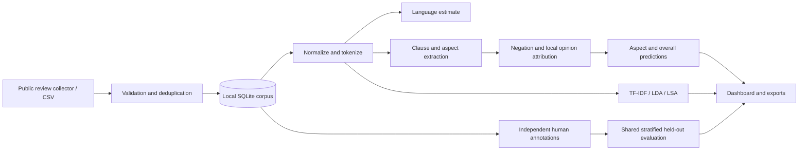

# Natural Language Processing Laboratory — Mini Project

**Program:** B.Tech. CSE (AI & ML) · **Semester:** V · **Course:** BCS25PC15

**Title:** Aspect-Based Opinion Mining on Real Marathi-English and Hindi-English Customer Reviews

**System name:** BhashaLens

Name: __________ · Roll number: __________ · Division: __________ · Date: __________

## Objectives

1. Implement a transparent NLP pipeline for naturally code-mixed customer reviews.
2. Identify explicit aspects and associate positive, negative, neutral, or mixed opinions with them.
3. Demonstrate normalization, tokenization, language estimation, morphology, POS, TF-IDF, language modelling, semantic representation, and topic discovery.
4. Compare rule and supervised sentiment baselines using independently annotated held-out data.
5. Explain individual decisions through aspect mentions, local clauses, and polarity cues.

## Expected outcomes

The student can implement text preprocessing (CO1), explain and run an English POS tagger with its multilingual limitations (CO2), compare sentiment classifiers (CO3), and construct a functioning local NLP application (CO4).

## Problem statement

A star rating compresses many opinions into one value. A review can praise food and criticize delivery. Marathi/Hindi speakers also mix English with Indic vocabulary and scripts. BhashaLens identifies which explicit aspect receives which opinion, preserving evidence and uncertainty about language rather than hiding those distinctions in a single label.

## Theory and concepts

Aspect-based sentiment analysis predicts aspect targets/categories and associated polarity. This implementation uses a predeclared aspect inventory and a transparent rule baseline. The original text is preserved. NFC-normalized text is tokenized with explicit Devanagari ranges that retain vowel marks. Token lexicons provide language estimates; common scripts and transliterations prevent perfect identification.

Clause splitting uses punctuation and contrast terms such as `but`, `pan`, `lekin`, `पण`, and `लेकिन`. Sentiment cues are attributed to the nearest explicit aspect in the same clause. Local negation changes cue polarity, including postposed Indic negation; intensifiers increase cue weight. Positive and negative evidence jointly produce a mixed label. Mentions without cues receive neutral polarity. These choices are inspectable, but can fail on implicit aspects, sarcasm, ellipsis, context-sensitive words, and long-distance syntax.

TF-IDF weights terms according to local document frequency and corpus rarity. LDA fits document/topic and topic/word distributions from count vectors to surface exploratory topics. Truncated SVD reduces TF-IDF to LSA document embeddings; cosine similarity retrieves neighboring reviews. Topic and similarity displays fit the exploration corpus and are not used to claim held-out classifier performance.

The bigram model estimates `P(w_i | w_(i-1)) = (count(w_(i-1), w_i) + 1) / (count(w_(i-1)) + |V|)` with sentence boundaries and an unknown token. Log probabilities avoid numeric underflow. Perplexity is `exp(-sum(log P)/N)`. The UI explicitly labels corpus/self-trained perplexity as demonstration output.

Optional NLTK resources provide English POS tags and WordNet noun lemmas. Porter stemming operates on Latin tokens, some of which can be Romanized Indic; such stems are not valid morphological analyses of Marathi/Hindi. URL and amount extraction is pattern-based entity extraction, not trained named-entity recognition.

## Architecture



## Dataset used and data description

**Acquisition performed on 20 October 2026:** 300 distinct public Zomato Google Play review records were retrieved; 205 unique review texts were imported after deduplication. Requested locales were `mr`, `hi`, and `en`. The acquisition manifest records the raw-file fingerprint. No real-review human annotations or real-data accuracy measurements have been produced yet. Language/code-mixing must be manually verified; retrieval locale and lexical estimates are insufficient.

The repository contains 24 **synthetic teaching fixtures**, not a real labelled benchmark. The real-review collector and CSV import support the intended project corpus. Complete the dataset card in ANNOTATION_GUIDE.md with actual collection and annotation counts before submission. Imported source metadata is not independently verified by the application.

Fields: text, source, source_url, language, collected_at. The collector additionally exports rating, retrieval locale, review date, source-ID hash, and a heuristic language estimate. SQLite stores imported core fields, demo status, and human annotation JSON. Extra collector fields remain in the original CSV and are not all retained by the app; preserve the raw CSV for reproducibility.

## Syllabus mapping

| Lab | Project component | Scope |
| --- | --- | --- |
| 1 Web data gathering | Public Play review collector | Requires network and upstream availability |
| 2 Language/count/tokenize | Language estimates and analyzer counts | Uses customer reviews, not HuffPost; confirm substitution with assessor |
| 3 Stem/lemmatize | Porter and optional WordNet inspector | English/Latin demonstration |
| 4 POS/embeddings/classification | Optional NLTK POS, LSA, TF-IDF logistic regression | Classifier uses TF-IDF, not POS features |
| 5 NER | Pattern-based URL/amount entities | Partial mapping; trained multilingual NER is not implemented |
| 6 TF-IDF | Corpus keywords and classifier features | Implemented |
| 7 N-grams | Bigram contexts and counts | Implemented |
| 8 Sequence probability | Add-one probabilities/log likelihood/perplexity | Demonstration model |
| 9 LSI or LDA | LSA/SVD and LDA | Implemented |
| 10 Sentiment/opinion mining | Four-way overall/aspect labels with topics | No separate emotion taxonomy/classifier |
| 11 Mini project | End-to-end workbench | Implemented |

The project integrates many syllabus techniques; it does not replace every exact assignment specification. It does not implement speech recognition, translation, transformer ABSA, or a dedicated emotion model.

## Algorithm

1. Read real review CSV; validate text, store provenance, deduplicate.
2. Preserve original text and normalize working text.
3. Tokenize and estimate token languages; report ambiguity.
4. Split clauses; identify lexicon aspect targets and opinion cues.
5. Apply local negation/intensifier rules and nearest-target attribution.
6. Aggregate aspect-level evidence; derive review-level sentiment separately.
7. Fit exploratory TF-IDF, LDA, and SVD on the selected corpus.
8. Independently annotate a real-review subset with overall and exhaustive aspect labels.
9. Evaluate majority/rules/word-TFIDF/char-TFIDF baselines on the same split.
10. Export predictions, human labels, and experiment manifest.

## Program code

Submitted source files: app.py, nlp.py, storage.py, experiments.py, scripts/, web/. Unit and integration tests are in tests/test_project.py. See README.md for exact setup and commands.

## Sample output

Input (synthetic): `Food khup chhan aahe pan delivery late hoti.`

```json
{
  "sentiment": "mixed",
  "aspects": [
    {"aspect": "Food", "sentiment": "positive", "score": 1.5},
    {"aspect": "Delivery", "sentiment": "negative", "score": -1.0}
  ]
}
```

Input (synthetic): `Service accha nahi hai. Food fresh hai.`

Expected: Service=negative with negated `accha`; Food=positive with `fresh`; overall=mixed.

## Experimental results

Do not invent values. After completing annotations, run the experiment and populate:

| Model | Test count | Accuracy | Macro-F1 (all four labels) |
| --- | --- | --- | --- |
| Majority baseline | pending | pending | pending |
| Explainable rule baseline | pending | pending | pending |
| Word TF-IDF + logistic regression | pending | pending | pending |
| Character TF-IDF + logistic regression | pending | pending | pending |

Also report aspect extraction F1, end-to-end aspect sentiment accuracy, class support, per-language breakdown calculated from the locked test set, annotation agreement, and representative failure cases. Current dashboard computes aggregate model/aspect metrics; per-language breakdown and agreement require an additional analysis of exported labels.

## Conclusion

The system demonstrates an inspectable approach to multilingual customer-review analysis with distinct opinions attached to explicit aspects. The local interface integrates practical NLP techniques with corpus management and fair baseline comparisons. Generalization to real code-mixed reviews must be established through independently annotated data and transparent error analysis. No real-world accuracy claim is established by the synthetic demo.

Assessor's remarks: __________________________________________________

Assessor's signature: ____________________ Date: ____________________
